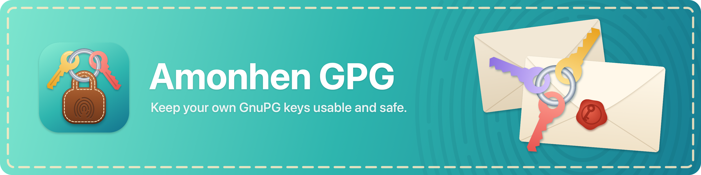
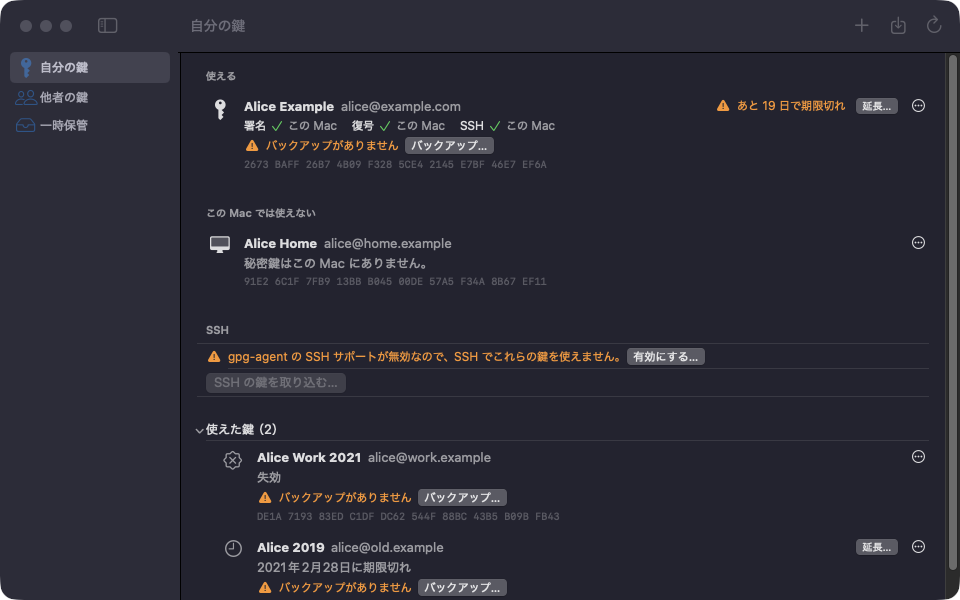

<h1></h1>

[](https://github.com/fukusaka/amonhen-gpg/actions/workflows/ci.yml)
[](#ライセンス)

[English](README.md)

自分の鍵を、使える状態で失わずに持ち続けるための GnuPG のフロントエンド。自分の鍵のどれで署名・復号・ログインが
できるか、それがどこにあるか（この Mac かスマートカードか）を示し、期限が切れる前や失いそうなときに知らせます。



## できること

- **自分の鍵が主役** — 自分の鍵を「使える」「この Mac では使えない」「使えた鍵」に分けて並べます。鍵ごとに、署名・
  復号・認証ができるか、どこでできるかを出します。
- **失わない** — バックアップや失効証明書のない鍵、期限が近い鍵を知らせます。鍵とサブ鍵の期限をまとめて延ばせます。
  秘密鍵を消すときは、先にバックアップを求め、フィンガープリントの最後の桁を打ってもらいます。
- **名前とメールアドレス** — 鍵の名前とメールアドレスを足す・主にする・失効させる。パスフレーズを変える。鍵を失効させ、
  鍵サーバーに送ってほかの人に知らせる。
- **他者の鍵** — 持ち主とフィンガープリントを照らし合わせてから確認済みにし、誰が確認したかを見られます。メールアドレス
  （WKD か keys.openpgp.org）やフィンガープリントで探した鍵は、取り込むまで一時保管の鍵束に置きます。
- **SSH** — 認証用のサブ鍵を gpg-agent 経由で SSH に使う。SSH サポートを有効にする。既存の SSH の鍵を取り込む。
  `authorized_keys` に書く公開鍵をコピーする。
- **純粋なフロントエンド** — 暗号の処理はすべて GnuPG が行います。パスフレーズは pinentry が聞き、アプリは触れません。

> [!WARNING]
> 開発の途中です。機能は予告なく変わることがあります。保証はありません。秘密鍵のバックアップは取っておいてください。

## インストール

Mac（macOS 14.4 以降、Apple シリコン）で、GnuPG 2.2 以降（2.4 以降を推奨）が要ります。[Homebrew](https://brew.sh)
（`brew install gnupg pinentry-mac`）、[GPG Suite](https://gpgtools.org)、MacGPG2 のどれでも使えます。

1. [snapshot](https://github.com/fukusaka/amonhen-gpg/releases/tag/snapshot) の pre-release から
   `Amonhen-GPG-Snapshot-<版>.zip` を取ってきます。最新の `main` で、署名はしてありますが、まだ公証していません。
2. 展開して、`Amonhen GPG Snapshot.app` を `/Applications` に移します。
3. 開きます。ブラウザで取ってきたものは、初回は macOS が止めるので、システム設定の「プライバシーとセキュリティ」で
   許可します。

アプリは `gpg` を `PATH`、Homebrew、GPG Suite の場所から探し、ふだんの鍵束（`~/.gnupg`）を開きます。パスフレーズの
画面を出せないときは、`pinentry-program` に pinentry-mac を設定する方法を示します。

自分でビルドするときは、[開発](#開発)を見てください。

## 文書

- [画面の方針](docs/ja/ui.md): それぞれの場所に何を出すか、アプリで何ができるか
- [アーキテクチャ](docs/ja/architecture.md): Rust のコア、バインディング、gpg の動かし方
- [GPG の GUI の調査](docs/ja/gpg-gui-survey.md)

## 開発

```bash
cargo test --workspace                      # Rust。結合テストは一時的な --homedir で gpg を動かす
scripts/build-core.sh && (cd apps/macos && swift test)
scripts/build-app.sh snapshot               # dist/Amonhen GPG Snapshot.app とその zip
scripts/snapshots.sh                        # サンプルの鍵束ですべての画面を dist/snapshots に撮る
```

テストも画面の撮影も `~/.gnupg` には触りません。一時的な鍵束（`scripts/sample-keyring.sh`）を使います。

## ライセンス

[MIT](LICENSE-MIT) か [Apache License 2.0](LICENSE-APACHE) の、好きな方で。
