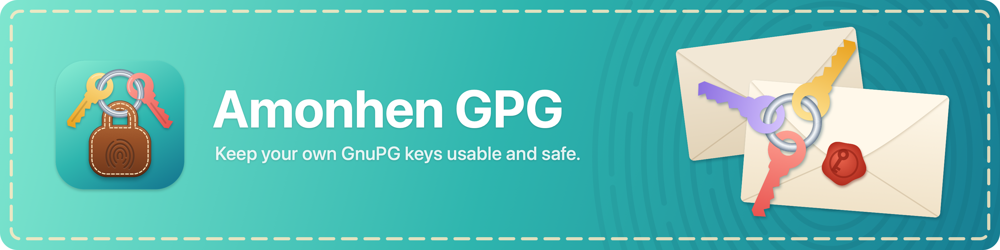
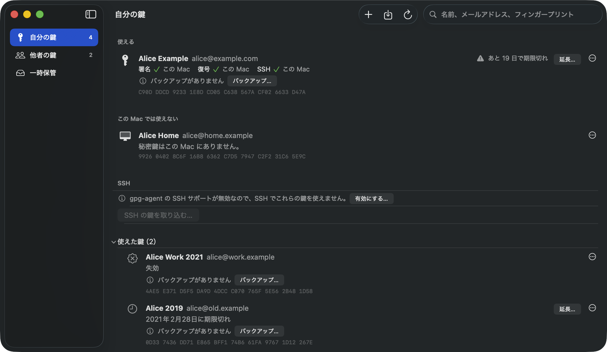

<h1></h1>

[](https://github.com/fukusaka/amonhen-gpg/actions/workflows/ci.yml)
[](https://github.com/fukusaka/amonhen-gpg/releases/latest)
[](#license)

[日本語](README.ja.md)

A front end for GnuPG that keeps your own keys usable and safe. It shows which of your keys you can sign, decrypt
and log in with, and where (this Mac or a smart card), and warns before a key expires or is lost for good.



## Features

- **Your keys first** — Your keys are grouped into usable, not usable on this Mac, and used before. Each shows
  whether it can sign, decrypt and authenticate, and where.
- **Don't lose them** — Warnings for keys without a backup or a revocation certificate, and for keys about to
  expire. Extend the expiry of a key and its subkeys at once. Deleting a secret key asks for a backup first and for the
  last digits of its fingerprint.
- **Your names and addresses** — Add, make primary or revoke the names and email addresses of a key. Change its
  passphrase. Revoke a key and tell others by sending it to a keyserver.
- **Others' keys** — Mark a key as verified only after comparing its fingerprint with its owner, and see who verified
  it. Keys found by email address (WKD or keys.openpgp.org), by fingerprint, or as published by a GitHub or GitLab
  user wait in a staging keyring until you import them.
- **SSH** — Use an authentication subkey for SSH through gpg-agent, turn SSH support on, add existing SSH keys and copy
  the public key for `authorized_keys`.
- **A pure front end** — GnuPG does all the cryptography. Passphrases go to pinentry and never through the app.

> [!WARNING]
> This is a work in progress. Features may change without notice, and it comes with no warranty. Keep backups of your
> secret keys.

## Installation

On a Mac (macOS 14.4 or later, Apple silicon), with GnuPG 2.4.6 or later (`brew install gnupg pinentry-mac`):

```sh
curl -fsSL https://raw.githubusercontent.com/fukusaka/amonhen-gpg/main/scripts/install-app.sh | sh -s -- stable
```

This installs the [latest release](https://github.com/fukusaka/amonhen-gpg/releases/latest) as `Amonhen GPG.app` in
`/Applications`. Run it again to update. For downloading by hand, the development snapshot, other folders and checking
a download, see [Installation](docs/install.md).

## Documents

- [Installation](docs/install.md)
- [Screen policy](docs/ui.md): what each place shows, and what the app can do
- [Architecture](docs/architecture.md): the Rust core, the bindings and how gpg is driven
- [Survey of GPG GUIs](docs/gpg-gui-survey.md)
- [SSH keys, host keys and git signers](docs/ssh-trust.md): design memo, not decided
- [Development](docs/development.md): building, testing and checking the screens

## License

[MIT](LICENSE-MIT) or [Apache License 2.0](LICENSE-APACHE), at your option.
